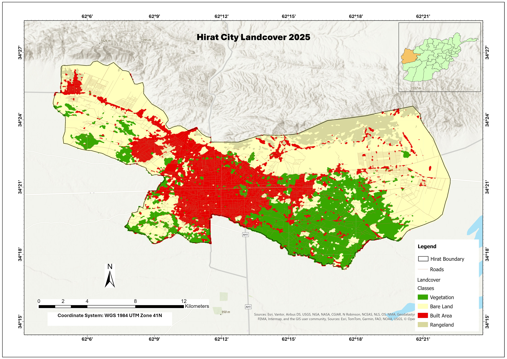
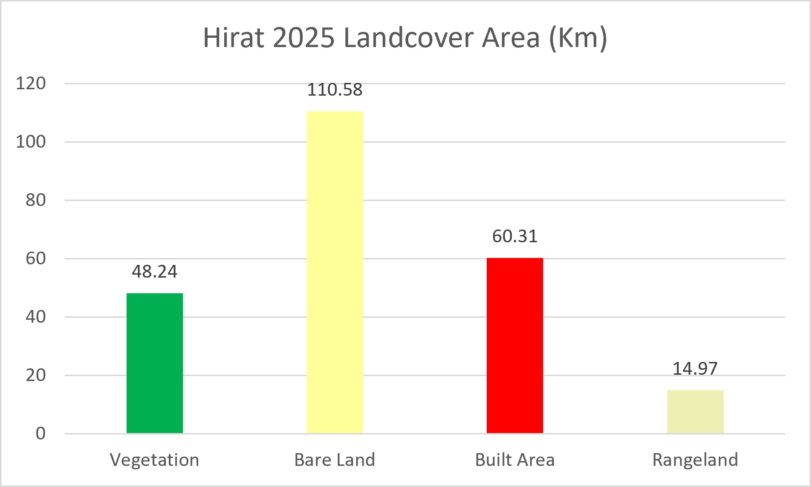

# Hirat City Land Cover Classification 2025

Land cover map of Hirat City, Afghanistan, produced with **Google Earth Engine (GEE)** and validated with **Google Earth** reference points.

## Overview

This project maps land cover across Hirat City for 2025 using satellite imagery and a supervised classification workflow in GEE. The output shows how built-up areas, vegetation, bare land, and rangeland are distributed across the city, and provides a baseline for urban planning, land management, and future change-detection work.

## Land Cover Classes

| Class | Description |
|---|---|
| Vegetation | Agricultural fields, orchards, and green cover |
| Bare Land | Exposed soil and sparsely vegetated land |
| Built Area | Buildings, roads, and other urban surfaces |
| Rangeland | Natural grassland and shrub areas |

## Results

| Class | Area (km²) | Share of total |
|---|---|---|
| Vegetation | 48.24 | 20.6% |
| Bare Land | 110.58 | 47.2% |
| Built Area | 60.31 | 25.8% |
| Rangeland | 14.97 | 6.4% |
| **Total** | **234.10** | **100%** |

**Key observations**
- Bare land is the largest class, covering almost half of the study area, mostly in the north and east.
- Built-up area is concentrated in the city center and extends along the northwest corridor.
- The densest vegetation lies in the southeast, forming a large agricultural belt.
- Rangeland is found mainly along the northern foothills.

## Methodology

1. **Study area:** Hirat City boundary.
2. **Data:** Landsat imagery (August 2025), cloud-masked and composited in GEE.
3. **Training data:** Sample points collected for each of the four classes.
4. **Classification:** SVM classifier in GEE.
5. **Accuracy assessment:** Independent validation points interpreted visually in Google Earth and compared against the classified map.
6. **Layout and mapping:** Final map produced in ArcGIS Pro, projected in WGS 1984 UTM Zone 41N.

## Accuracy Assessment

| Metric | Value |
|---|---|
| Overall Accuracy | `[81.91 %]` |
| Kappa Coefficient | `[0.745]` |
| Number of validation points | `[94]` |

## Tools & Technologies

- Google Earth Engine
- Google Earth Pro (validation)
- ArcGIS Pro (cartography)
- Microsoft Excel (area statistics and charts)

## Limitations

- Classification is limited by the spatial resolution of the input imagery.
- Spectral similarity between bare land, rangeland, and some built surfaces may cause misclassification.
- Accuracy depends on the number and quality of the training and validation samples.

## Author

**Hamayon Muradi**
GIS & Remote Sensing Engineer, Kabul, Afghanistan

Email: hamayonmuradi8@gmail.com

